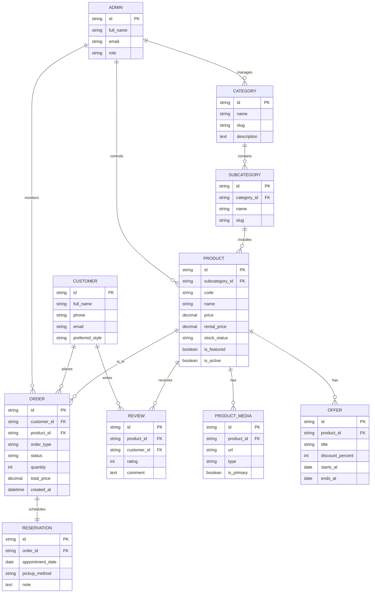

# ERD for the Bridal Boutique Project

This project is modeled around a boutique e-commerce and admin system for bridal, engagement, and evening dresses.

## Main relationships

- One category contains many subcategories.
- One subcategory contains many products.
- One product can have many media files and offers.
- One customer can place many orders and create many reviews.
- One order can have one reservation.
- Admin users manage categories, products, and orders.

## Notes for implementation

This structure matches the storefront and admin dashboard already present in the project, including:

- main categories
- subcategories
- products / dresses
- rental and purchase flows
- customer orders and reservations
- promotional offers
- admin control panels
